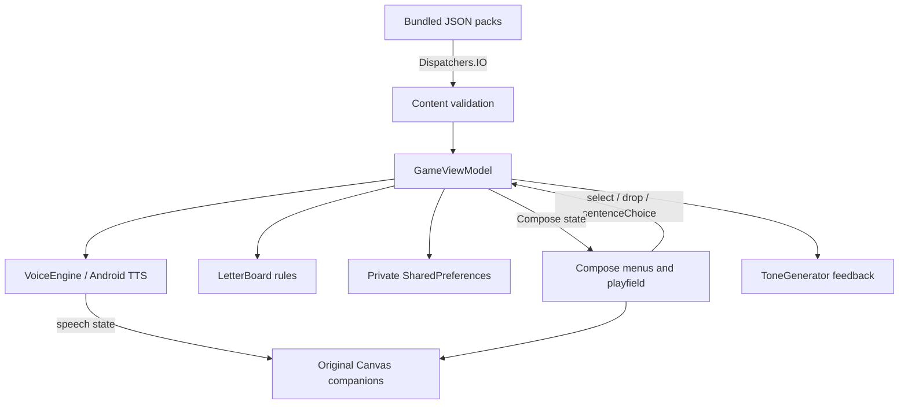

# Reading Adventure architecture

This describes the independently written project inspected on 2026-10-19. It is based on repository source, not decompiled Endless Reader code. Build/test results are separate evidence; source inspection alone does not establish runtime correctness, audio quality or frame rate.

## Application boundary

One Android application module uses Kotlin, Jetpack Compose Material 3 and Compose Canvas. The application ID is `com.learning.readingadventure`; compile/target SDK is 35 and minimum SDK is 26. Java/Kotlin bytecode targets JVM 17. The app declares a launcher activity and a TTS-service visibility query. Its source manifest requests no permissions and disables Android backup. It has no account, purchase, advertising, tracking or server client code. Check the final merged manifest before making APK-level claims.

No native game libraries are required by project source; it is not restricted to one ABI. ARM64 compatibility still requires confirming the built APK and running it on the intended device. The original application's package, assets and installation are not dependencies.

## Components and data flow

| Source | Responsibility |
|---|---|
| `MainActivity.kt` | Activity lifecycle, garden menu, parent gate/settings, letter playfield, sentence choice UI and procedural companion rendering |
| `GameViewModel.kt` | Activity-scoped application state, coroutine content loading, current word/board/phase, progression and preferences |
| `GameModel.kt` | Content data types, matching model, progression rules, audio-generation tokens and motion helpers |
| `Content.kt` | Parse and validate local JSON packs, then combine packs with duplicate-ID checks |
| `SpeechEngine.kt` | Replaceable `VoiceEngine` contract, Android TTS backend, local voice selection, audio focus and synthesized feedback |
| `assets/content/core.json` | Original 108-word pack with sentences and presentation metadata |

## Actual learning loop

The garden groups words into three levels, each containing 36 bundled entries. A child selects an unlocked word; its pronunciation starts and letters appear in a shuffled tray. Letter placement supports dragging and an accessible tap-letter/tap-target path. `LetterBoard` stores `tileIndex → slotIndex`, separately enforcing unused tile IDs, unoccupied slots, valid bounds and equal characters. This handles repeated letters without conflating a tile with its destination.

Completing the letter board advances to a sentence with one blank and three word choices. An incorrect choice repeats the word; a correct choice records the unique word ID, speaks the sentence and enters celebration. Replaying does not increase distinct completion count. Completing 12 words in level 1 opens level 2; completing 12 in each of levels 1 and 2 opens level 3. `next()` prefers an uncompleted unlocked word and cycles after completion. There is no score or time penalty.

Completion IDs, app volume and letter-cue preference persist in private SharedPreferences. Current word, assignments and phase live in the retained ViewModel, surviving normal activity recreation; they are not presently serialized for process death. A math challenge gates parent settings and a second confirmation protects progress reset. This is accidental-access prevention, not an authentication system.

## Content extension

`Content.load()` reads every `.json` file under `assets/content`, in sorted order, on an IO dispatcher. Schema version 1 supplies `id`, `text`, `difficulty`, `pronunciation`, `sentence`, `animation` and optional `character`. The parser checks unique IDs within/across packs, lowercase words of 1–8 letters, difficulty 1–3, nonblank pronunciation and whole-word sentence inclusion. The bundled maximum length is six letters. Additional packs can be bundled in the same directory without a network service, preserving stable IDs for progress.

Validation does not replace educational review: irregular pronunciation, phoneme quality and difficulty sequencing require human checking. The pack has animation configuration fields; rendering behavior must be verified against their consumption in code before treating them as supported per-word animation controls.

## Rendering and animation

Letters are Compose boxes with transform/shadow effects; placement uses Compose animation APIs and gestures. `GardenScene` draws Pip (a golden seed) and Moss (a green leaf companion) from original Canvas primitives. Motion includes sway, bounce, blinking, arm movement, speech-active mouth movement and a bounded 28-particle celebration. No proprietary images, recordings or animation clips are bundled. The launcher artwork is an original Android vector resource.

This is a procedural animation system built on Compose's frame clock, not a skeletal-animation or video engine. Layout switches to a compact composition below 500 dp screen height and observes safe drawing insets. Letter/tray positions are computed from actual playfield constraints. Rotation, drag cancellation, narrow screens, font scaling and sentence-choice width need UI/device validation. A single-column layout and eight-letter extension packs should not be assumed accessible merely because six-letter bundled content fits the target phone.

No physical-device frame pacing or memory trace has yet established 60 FPS or bounded long-session memory. Several per-letter animation transitions and Canvas draws run continuously; avoid claiming zero allocation or zero main-thread work. Small preference reads, audio engine calls and ToneGenerator creation also occur on the UI thread. Content file parsing is explicitly off-thread.

## Speech and audio boundary

`VoiceEngine` exposes speaking/status flows, volume, speak, stop and close. A future original-recording backend can implement it without replacing matching or progression. The current backend chooses English voices advertised as local, excludes network-required/not-installed voices, and requests transient audio focus. Generation tokens reject obsolete completion callbacks. A timeout avoids indefinitely stuck speech state. Stopping clears pending/completion callbacks; activity stop silences audio and ViewModel teardown shuts the TTS engine down.

Speech-active animation is coarse synchronization. There is no phoneme alignment, word-range highlight timeline or lip-sync data. The optional letter-sound mode uses explicitly labeled text approximations; default cues use letter names. Voice pronunciation varies by installed engine. Feedback uses platform synthesized tones, with volume linked to the app preference. No Media3 dependency is necessary for this TTS-and-tone implementation; no recorded-media playback backend is implemented yet.

Silent gameplay works without a voice, but spoken offline gameplay depends on installed offline English TTS data. No network voice should be used as fallback. The app displays parent guidance when local speech is unavailable. Airplane-mode testing must verify the actual phone/voice combination. Bundled narration would be needed to guarantee speech on every fresh device independently of TTS installation.

## Verification boundaries

Host tests exist for matching, repeated letters, progression, audio-generation tokens, content and motion helpers. Robolectric Compose UI tests exercise a complete one-letter activity and parent-gate rejection; an instrumentation smoke test exists for device execution. Their presence does not imply they have passed. Host token tests do not test real TTS callback order, and motion-helper tests do not measure rendered motion. The device test's name does not disable network; an offline claim requires independently verified network state.

Reference APK acquisition remains blocked by HTTP 403, as documented in [reverse-engineering.md](reverse-engineering.md). No original app internals were used to assert this architecture. Read the current build/test evidence and final delivery notes for verified status and remaining limitations.
